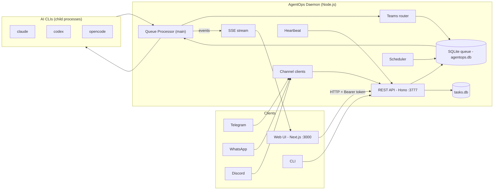
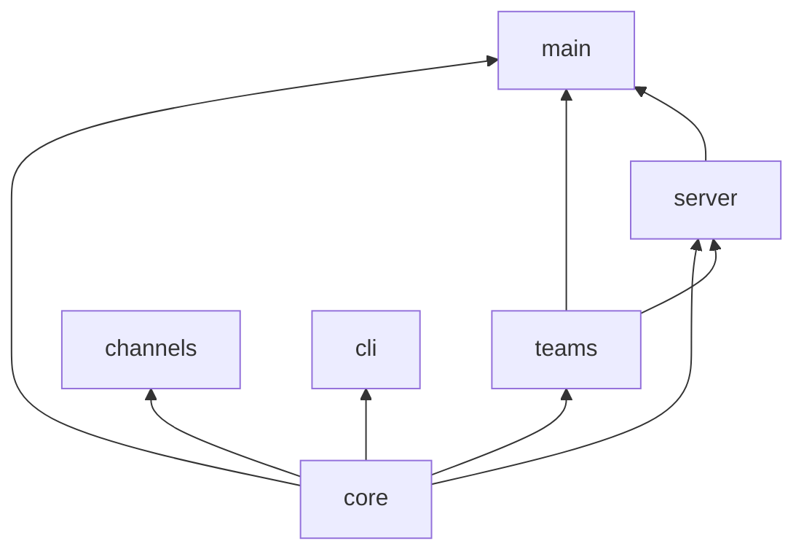
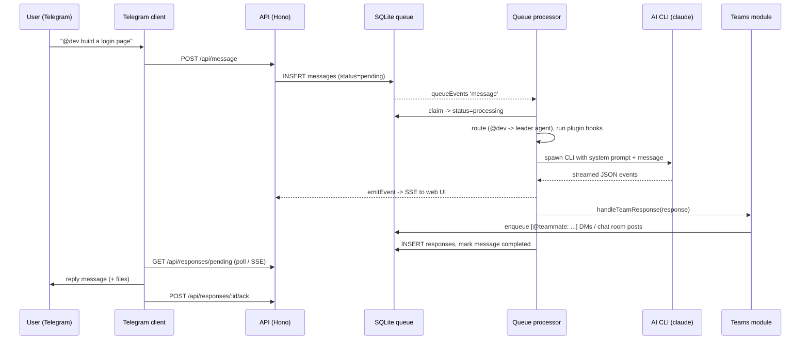

# AgentOps — Complete Project Documentation

> **One-line summary:** AgentOps is a self-hosted, 24/7 **multi-agent, multi-team, multi-channel AI assistant platform**. Users talk to teams of AI agents (powered by Claude, OpenAI Codex or OpenCode) through **Telegram, WhatsApp, Discord** or a **web dashboard ("AgentOps Office")**, and the agents can collaborate with each other, remember things, run on schedules and manage tasks on a kanban board.

---

## Table of Contents
1. [Problem Statement & Objectives](#1-problem-statement--objectives)
2. [Key Features](#2-key-features)
3. [Tech Stack](#3-tech-stack)
4. [High-Level Architecture](#4-high-level-architecture)
5. [Frontend vs Backend Separation](#5-frontend-vs-backend-separation)
6. [Monorepo Structure (Packages)](#6-monorepo-structure-packages)
7. [How It Works — End-to-End Message Flow](#7-how-it-works--end-to-end-message-flow)
8. [Agent-to-Agent Communication (Teams)](#8-agent-to-agent-communication-teams)
9. [Database Design](#9-database-design)
10. [REST API Reference](#10-rest-api-reference)
11. [Real-Time Updates (SSE)](#11-real-time-updates-sse)
12. [Frontend (AgentOps Office) in Detail](#12-frontend-agentops-office-in-detail)
13. [Messaging Channels](#13-messaging-channels)
14. [AI Provider Adapters](#14-ai-provider-adapters)
15. [Memory, Soul & Skills](#15-memory-soul--skills)
16. [Heartbeat & Scheduler](#16-heartbeat--scheduler)
17. [Security](#17-security)
18. [Reliability & Fault Tolerance](#18-reliability--fault-tolerance)
19. [CLI](#19-cli)
20. [Configuration](#20-configuration)
21. [Deployment (Docker)](#21-deployment-docker)
22. [Testing](#22-testing)
23. [Design Patterns Used](#23-design-patterns-used)
24. [Limitations & Future Scope](#24-limitations--future-scope)
25. [Viva Questions & Answers](#25-viva-questions--answers)

---

## 1. Problem Statement & Objectives

**Problem:** Single AI chatbots (like a ChatGPT tab) are reactive, forget context, cannot work as a *team*, are not reachable from everyday messaging apps, and cannot run tasks on their own in the background.

**Objectives:**
- Run **multiple specialised AI agents** (e.g. coder, reviewer, researcher) that can **talk to each other**.
- Group agents into **teams** with a **leader** and a shared **chat room**.
- Make agents reachable from **Telegram, WhatsApp, Discord** and a **web UI**.
- Run **24/7** with a durable **message queue**, **heartbeats** and **scheduled tasks**.
- Give agents **persistent memory** and a **personality (soul)**.
- Be **provider-agnostic** — support Anthropic Claude, OpenAI Codex, OpenCode and custom endpoints.
- Be **self-hosted and secure** (local token auth, sandboxed file access).

---

## 2. Key Features

| Feature | Description |
|---|---|
| Multi-agent | Each agent has its own provider, model, workspace folder and system prompt |
| Teams | Agents grouped with a `leader_agent`; messages to `@team` go to the leader |
| Agent DMs | Agents write `[@coder: fix bug]` to message a teammate (parallel fan-out supported) |
| Team chat room | `[#dev: update]` broadcasts to all teammates (like Slack) |
| Multi-channel | Telegram, WhatsApp, Discord, Web dashboard, CLI |
| Durable queue | SQLite-backed queue with retries, dead-letter queue, crash recovery |
| Kanban tasks | Projects, tasks (backlog → todo → in_progress → review → done), comments |
| Scheduler | Cron-based recurring or one-time messages to agents |
| Heartbeat | Periodically "wakes" agents so they can act proactively |
| Memory | Hierarchical markdown memory per agent, indexed into the prompt |
| Skills | Pluggable instruction packs (browser automation, image gen, etc.) |
| Pixel office | Animated pixel-art office showing agents working live |
| Pairing | New senders on messaging apps must be approved with a pairing code |
| Plugins/Hooks | Incoming-message hooks to extend behaviour |

---

## 3. Tech Stack

### Language & Runtime
- **TypeScript 5.9** (entire codebase, strongly typed)
- **Node.js ≥ 22.12** (backend runtime)
- **npm workspaces** (monorepo management)

### Backend
| Tech | Purpose |
|---|---|
| **Hono** + `@hono/node-server` | Lightweight, fast web framework for the REST API |
| **better-sqlite3** | Embedded SQL database (queue, chats, tasks) — synchronous, fast, zero-setup |
| **SQLite WAL mode** | Allows concurrent reads while writing |
| **croner** | Cron expression scheduling |
| **nanoid** | Unique ID generation |
| **dotenv** | Environment variables |
| **jsonrepair** | Repairs malformed JSON emitted by LLM CLIs |
| **child_process.spawn** | Runs AI CLIs (claude / codex / opencode) as subprocesses |
| **Server-Sent Events (SSE)** | Real-time push to the web UI |

### Channels
| Tech | Purpose |
|---|---|
| **grammY** | Telegram Bot API |
| **discord.js** | Discord bot |
| **whatsapp-web.js** + **Puppeteer** | WhatsApp via headless Chromium (QR login) |
| **qrcode-terminal** | Shows WhatsApp QR code in terminal |

### Frontend (`agentops-office`)
| Tech | Purpose |
|---|---|
| **Next.js 16** (App Router) | React framework, file-based routing |
| **React 19** | UI library |
| **Tailwind CSS v4** | Utility-first styling |
| **Radix UI** + shadcn-style components | Accessible UI primitives (dialogs, dropdowns, tooltips) |
| **lucide-react** | Icons |
| **@dnd-kit** | Drag-and-drop for the kanban board |
| **@xyflow/react** (React Flow) + **dagre** | Team/org-chart graph visualisation and auto-layout |
| **react-markdown**, remark-gfm, **shiki**, marked | Markdown rendering & code syntax highlighting |
| **next-themes** | Dark/light mode |
| **date-fns**, react-day-picker | Dates and calendar (schedules) |
| **use-stick-to-bottom** | Auto-scrolling chat |

### CLI & Terminal UI
- **@clack/prompts** — interactive CLI setup wizard
- **Ink** (React for terminal) + ink-spinner, ink-gradient — terminal team visualizer

### DevOps / Tooling
- **Docker** (multi-stage) + **docker-compose**
- **concurrently**, **nodemon**, **tsx** — dev workflow
- **ESLint** — linting
- **node:test** — built-in Node test runner; **jsdom** for frontend tests

---

## 4. High-Level Architecture

AgentOps uses a **layered, event-driven, queue-based architecture** organised as a **modular monorepo**. It is a **client–server** system where the backend is a single long-running **daemon** process and all clients (web UI, bots, CLI) talk to it through a **REST API on port 3777**.



### Architectural styles used
1. **Client–Server** — clients never touch the DB; only the API.
2. **Layered** — `core` (domain/infra) → `teams` (orchestration) → `server` (HTTP) → `main` (composition/entry).
3. **Producer–Consumer / Message Queue** — every incoming message is enqueued; a processor consumes per-agent.
4. **Event-driven** — internal `EventEmitter` (`queueEvents`, `emitEvent`) → pushed to the browser via SSE.
5. **Adapter pattern** — one interface for Claude/Codex/OpenCode providers.
6. **Modular Monorepo** — independent npm packages with clear dependency direction.

---

## 5. Frontend vs Backend Separation

| Aspect | Frontend (`agentops-office/`) | Backend (`packages/*`) |
|---|---|---|
| Framework | Next.js 16 + React 19 | Node.js + Hono |
| Port | `3000` | `3777` |
| Responsibility | Presentation, user interaction | Business logic, queue, AI execution, DB |
| Data access | Only via HTTP `fetch` to API | Direct SQLite + filesystem |
| State | React hooks, `localStorage`/`sessionStorage` | SQLite DBs, `settings.json`, files |
| Real-time | `EventSource` on `/api/events/stream` | Broadcasts SSE events |
| Deployed | Separately (`next dev` / `next build`) | As daemon / Docker container |

**How they are decoupled:**
- The frontend is a **separate Next.js app** in its own folder with its own `package.json`; it is **not** part of the backend npm workspace.
- The only contract between them is the **REST API + SSE** (JSON over HTTP). See [api.ts](file:///d:/AgentOps/agentops-office/src/lib/api.ts).
- The API base URL is configurable: `NEXT_PUBLIC_API_URL` env → `localStorage` → default `http://localhost:3777`.
- **Authentication:** the user pastes the API token (auto-generated in `~/.agentops/api-token`) into the UI; it is stored in `sessionStorage` and sent as `Authorization: Bearer <token>`.
- **CORS:** backend only allows origins in `AGENTOPS_ALLOWED_ORIGINS` (default `http://localhost:3000`).
- Because of this separation, the same backend also serves the Telegram/Discord/WhatsApp bots and CLI — they are just other API clients.

---

## 6. Monorepo Structure (Packages)

```
AgentOps/
├── packages/
│   ├── core/        # Domain + infrastructure: config, queue DB, agent invoke, adapters, memory, security, scheduler
│   ├── teams/       # Team orchestration: tag parsing, DMs, chat rooms
│   ├── server/      # Hono REST API, SSE, tasks DB, route modules
│   ├── main/        # Entry point: queue processor, channels supervisor, heartbeat
│   ├── channels/    # Telegram, Discord, WhatsApp bot clients
│   ├── cli/         # `agentops` command-line tool
│   └── visualizer/  # Terminal (Ink) team visualizer & chatroom viewer
├── agentops-office/ # Next.js web dashboard (frontend)
├── .agents/skills/  # Built-in skills (memory, tasks, schedule, browser…)
├── tests/           # Backend tests (node:test)
├── Dockerfile, docker-compose.yml
├── AGENTS.md, SOUL.md, heartbeat.md   # Agent instruction templates
└── package.json     # npm workspaces root
```

**Dependency direction (no cycles):**


### Important files
| File | Role |
|---|---|
| [main/src/index.ts](file:///d:/AgentOps/packages/main/src/index.ts) | Daemon entry: init DB, start API, process queue |
| [core/src/queues.ts](file:///d:/AgentOps/packages/core/src/queues.ts) | SQLite queue schema & operations |
| [core/src/invoke.ts](file:///d:/AgentOps/packages/core/src/invoke.ts) | Spawns AI CLI processes, streams output |
| [core/src/adapters/](file:///d:/AgentOps/packages/core/src/adapters) | Claude / Codex / OpenCode adapters |
| [core/src/config.ts](file:///d:/AgentOps/packages/core/src/config.ts) | Settings loading, model resolution |
| [core/src/security.ts](file:///d:/AgentOps/packages/core/src/security.ts) | API token, path sandboxing, secret redaction |
| [core/src/memory.ts](file:///d:/AgentOps/packages/core/src/memory.ts) | Memory index builder |
| [core/src/schedules.ts](file:///d:/AgentOps/packages/core/src/schedules.ts) | Cron scheduler |
| [teams/src/routing.ts](file:///d:/AgentOps/packages/teams/src/routing.ts) | `[@agent: …]` / `[#team: …]` parser |
| [teams/src/conversation.ts](file:///d:/AgentOps/packages/teams/src/conversation.ts) | Team response handling & fan-out |
| [server/src/index.ts](file:///d:/AgentOps/packages/server/src/index.ts) | Hono app, auth middleware, routes, SSE |
| [server/src/tasks-db.ts](file:///d:/AgentOps/packages/server/src/tasks-db.ts) | Projects/tasks/comments DB |
| [main/src/heartbeat.ts](file:///d:/AgentOps/packages/main/src/heartbeat.ts) | Heartbeat loop |

---

## 7. How It Works — End-to-End Message Flow



**Step by step:**
1. **Ingest** — a channel client (or web UI) calls `POST /api/message`. The message is stored in the `messages` table with `status='pending'`.
2. **Wake-up** — `queueEvents` emits an event; the processor picks up agents that have pending work (`getPendingAgents`).
3. **Per-agent serialisation** — each agent processes **one message at a time** (messages are claimed and marked `processing`), but **different agents run in parallel**.
4. **Routing** — `parseAgentRouting` reads `@agent` / `@team` prefixes. A team routes to its **leader**. Unknown → default `agentops` agent.
5. **Hooks** — plugins can transform the incoming message (`runIncomingHooks`).
6. **Prompt building** — system prompt = agent prompt + `AGENTS.md` instructions + teammates list + memory index + soul.
7. **Invoke** — `invokeAgent` spawns the provider CLI (`claude`, `codex`, `opencode`) in the agent's **working directory**, resuming the per-thread **session id** so context is kept.
8. **Streaming** — stdout is read line-by-line, parsed into events, and broadcast via SSE (the UI shows live "typing"/tool activity).
9. **Team handling** — the response is scanned for `[@agent: …]` and `[#team: …]` tags; new internal messages are enqueued (with `depth+1`).
10. **Respond** — the clean response is inserted into `responses`; the channel client fetches it, delivers it, and **acks** it.
11. **Complete/Fail** — message marked `completed`, or on error `retry_count++`; after 5 retries it goes to the **dead-letter queue**.

---

## 8. Agent-to-Agent Communication (Teams)

- A **team** = `{ name, agents[], leader_agent }`.
- Agents communicate by writing **bracket tags** in their response:

| Syntax | Meaning |
|---|---|
| `[@coder: fix the bug]` | DM to one teammate |
| `[@coder: A] [@tester: B]` | Different messages, run in parallel |
| `[@coder,tester: status?]` | Same message to many |
| `[@sam\|final: done]` | Final notification — recorded, does **not** invoke Sam |
| `[#dev: deployed]` | Broadcast to team chat room |
| Text outside tags | Shared context delivered to all mentioned agents |

- **Parser:** [extractBracketTags](file:///d:/AgentOps/packages/teams/src/routing.ts) uses **bracket-depth counting** so nested brackets like `[@coder: fix arr[0]]` work.
- **Stateless orchestration:** there is no central conversation object; each DM is simply a new queue message with `fromAgent`, `teamId`, `threadId`, `rootMessageId`, `depth`.
- **Loop protection:** `max_chain_depth`, `max_agent_messages_per_minute` (rate limit) and turn/idle timeouts prevent infinite agent ping-pong.

---

## 9. Database Design

Two **SQLite** files in `~/.agentops/`:

### `agentops.db` (queue & conversations) — WAL mode, busy_timeout 5000ms
| Table | Key columns | Purpose |
|---|---|---|
| `messages` | message_id (unique), channel, sender, message, agent, from_agent, status, retry_count, team_id, thread_id, root_message_id, depth | Incoming work queue |
| `responses` | message_id, channel, message, agent, files, metadata, status, acked_at | Outgoing replies to deliver |
| `chat_messages` | team_id, from_agent, message | Team chat room history |
| `agent_messages` | agent_id, role, channel, content | Per-agent chat history (UI) |
| `thread_sessions` | (agent_id, thread_id, provider) PK, session_id | Resume AI CLI sessions per thread |

**Message status lifecycle:** `pending → processing → completed` or `→ dead` (after 5 failures).
**Indexes:** `idx_msg_status(status, agent, created_at)`, `idx_resp_channel`, `idx_chat_team`, `idx_agent_messages_agent`.
**Migrations:** done at startup with `PRAGMA table_info` + `ALTER TABLE` (idempotent).

### `tasks.db` (kanban)
| Table | Purpose |
|---|---|
| `projects` | id, name, description, prefix (e.g. `SYS`), color, status (active/archived) |
| `tasks` | id, number, title, description, status, assignee, assigneeType (agent/team), projectId, sortOrder → identifier like `SYS-1` |
| `comments` | taskId, author, authorType (user/agent), content |

### File-based storage
- `~/.agentops/settings.json` — agents, teams, providers, channels config
- `~/.agentops/api-token` — random 32-byte hex token (mode 0600)
- `~/.agentops/files/` — file exchange with the user
- Agent workspace: `AGENTS.md`, `.agentops/SOUL.md`, `memory/*.md`, skills

**Why SQLite?** Zero configuration, single file, embedded (no separate DB server), ACID transactions, fast for a single-host daemon, and survives crashes — ideal for a self-hosted assistant.

---

## 10. REST API Reference

Base: `http://localhost:3777`, all routes require `Authorization: Bearer <token>`.

| Area | Endpoints |
|---|---|
| System | `GET /api/status`, `GET /api/capabilities`, `GET /api/events/stream` (SSE), `GET /api/logs` |
| Messages | `POST /api/message` |
| Agents | `GET /api/agents`, `PUT/DELETE /api/agents/:id`, `GET/PUT …/system-prompt`, `GET …/memory`, `GET/PUT …/heartbeat`, `GET …/skills`, `GET …/skills/registry`, `POST …/skills/install`, `GET /api/agents/:id/messages` |
| Runs | `GET /api/agents/:id/runs`, `…/runs/search`, `…/runs/:run`, `…/runs/:run/context`, `GET/PUT …/checkpoint` |
| Teams | `GET /api/teams`, `PUT/DELETE /api/teams/:id`, `GET/POST /api/chatroom/:teamId` |
| Queue | `GET /api/queue/status`, `/agents`, `/processing`, `POST /processing/:id/kill`, `GET /api/queue/dead`, `POST /dead/:id/retry`, `DELETE /dead/:id` |
| Responses | `GET /api/responses`, `GET /api/responses/pending`, `POST /api/responses`, `POST /api/responses/:id/ack`, `GET /api/attachments/:messageId/:agentId/:index` |
| Tasks | `GET/POST /api/tasks`, `GET/PUT/DELETE /api/tasks/:id`, `PUT /api/tasks/reorder`, `GET/POST /api/tasks/:id/comments`, `DELETE /api/comments/:id` |
| Projects | `GET/POST /api/projects`, `GET/PUT/DELETE /api/projects/:id` |
| Schedules | `GET/POST /api/schedules`, `PUT/DELETE /api/schedules/:id` |
| Settings | `GET/PUT /api/settings`, `POST /api/setup`, `GET/PUT/DELETE /api/custom-providers/:id` |
| Services | `POST /api/services/apply`, `/restart`, `/stop`, `/channel/:id/start|stop|restart` |
| Pairing | `GET /api/pairing`, `POST /api/pairing/approve`, `DELETE /api/pairing/:channel/:senderId`, `DELETE /api/pairing/pending/:code` |
| Chats | `GET /api/chats` |

**Error handling:** `400` for config/JSON errors, `401` bad token, `403` disallowed origin, `404` JSON fallback, `500` logged errors.

---

## 11. Real-Time Updates (SSE)

- Endpoint: `GET /api/events/stream` (`Content-Type: text/event-stream`).
- Backend: [sse.ts](file:///d:/AgentOps/packages/server/src/sse.ts) keeps a `Set` of open responses; `onEvent()` from core forwards every internal event via `broadcastSSE`.
- Frontend: hooks like `use-office-sse.ts` use `EventSource` to update the pixel office, chat views and queue live.
- **Why SSE over WebSockets?** Updates are one-way (server → client), SSE is plain HTTP, auto-reconnects, simpler, works through proxies; client → server actions use normal REST.

---

## 12. Frontend (AgentOps Office) in Detail

**Routing (Next.js App Router, `src/app/`):**
| Route | Page |
|---|---|
| `/` (office group) | Animated **pixel-art office** — agents sit at desks, show speech bubbles when working |
| `/company` | Organisation overview |
| `/projects`, `/projects/[id]`, `/projects/tasks` | Projects & **kanban board** (drag-and-drop) |
| `/agents`, `/agents/[id]` | Agent list & detail tabs: chat, system prompt, memory, skills (constellation view), schedule, heartbeat |
| `/teams`, `/team/[id]` | Teams, team graph (React Flow + dagre) and chat room |
| `/control` | Queue control: processing, dead-letter, retry/kill |
| `/settings` | Providers, channels, API URL/token, pairing |

**Structure:**
- `components/ui/` — reusable design-system components (button, modal, sheet, kanban, markdown, code-block, prompt-input…)
- `components/office/` — pixel office scene, characters, overlays, SSE & data hooks
- `components/agent/`, `components/task/` — feature components
- `lib/api.ts` — typed API client (single place for all HTTP calls)
- `lib/hooks.ts`, `hooks/` — custom React hooks (polling, media queries, sidebar)
- `theme-provider.tsx` — dark/light theme via `next-themes`

**Pixel office assets:** sprites in `public/assets/pixel-agents/` (desks, PCs with animated screens, plants, sofas…), each with a `manifest.json`.

---

## 13. Messaging Channels

Located in `packages/channels/src/`. Each runs as a supervised child of the daemon ([main/src/channels.ts](file:///d:/AgentOps/packages/main/src/channels.ts), [supervisor.ts](file:///d:/AgentOps/packages/main/src/supervisor.ts)).

| Channel | Library | Login |
|---|---|---|
| Telegram | grammY | `TELEGRAM_BOT_TOKEN` |
| Discord | discord.js | `DISCORD_BOT_TOKEN` |
| WhatsApp | whatsapp-web.js + Puppeteer | QR code scan |

- Channel clients are **thin API clients**: they forward messages via `POST /api/message` and listen (via [sse-client.ts](file:///d:/AgentOps/packages/channels/src/sse-client.ts)) for responses to deliver, then ack.
- Supports text, photos, documents, audio, voice, video, stickers; outgoing files via `[send_file: /path]` tag.
- **Pairing:** unknown senders get a pairing code; owner approves it (CLI/UI) before the bot will respond — prevents strangers using your agents.
- `default-agent.ts` lets a user set a default agent per channel.

---

## 14. AI Provider Adapters

AgentOps does **not** call LLM HTTP APIs directly — it orchestrates **agentic coding CLIs** which already include tool use (shell, file edit, web).

| Provider | CLI | Notes |
|---|---|---|
| `anthropic` | `claude` (Claude Code) | aliases `sonnet`, `opus` |
| `openai` | `codex` | e.g. `gpt-5.3-codex` |
| `opencode` | `opencode` | multi-model |
| `custom:<id>` | any of the above harnesses | custom `base_url`, `api_key`, `model` |

- Common interface in [adapters/types.ts](file:///d:/AgentOps/packages/core/src/adapters/types.ts); each adapter builds CLI args and parses its streaming JSON events into a common event format ([events.ts](file:///d:/AgentOps/packages/core/src/adapters/events.ts)).
- Sessions are saved in `thread_sessions` so each conversation thread continues the same AI session.
- `killAgentProcess` sends SIGTERM then SIGKILL after 2s.
- `unrestricted_execution` flag controls shell access per agent.

---

## 15. Memory, Soul & Skills

- **Memory** — markdown files in the agent's `memory/` folder with YAML frontmatter (`name`, `summary`). [memory.ts](file:///d:/AgentOps/packages/core/src/memory.ts) recursively scans folders (reading only first 16 KB for frontmatter) and builds an **index** injected into the prompt (bounded by `memory_index_max_chars`). The agent opens full files on demand → saves tokens.
- **Soul** — `.agentops/SOUL.md` defines the agent's identity, personality and opinions; evolves over time.
- **AGENTS.md** — per-agent setup & system prompt, plus teammate list auto-inserted between `TEAMMATES_START/END` markers.
- **Skills** — folders with `SKILL.md` (instructions + scripts) e.g. memory, tasks, schedule, send-user-message, agent-browser, imagegen, session-continuity. Installable from a registry via the API.
- **Run harness / checkpoints** — [harness.ts](file:///d:/AgentOps/packages/core/src/harness.ts) records each run (usage, session) and lets agents save checkpoints for long tasks.

---

## 16. Heartbeat & Scheduler

- **Heartbeat** ([heartbeat.ts](file:///d:/AgentOps/packages/main/src/heartbeat.ts)) — every `heartbeat_interval` seconds (default 3600) sends the contents of `heartbeat.md` to each enabled agent via the API, **skipping agents that already have pending work**. Makes agents **proactive** (check tasks, send reminders).
- **Scheduler** ([schedules.ts](file:///d:/AgentOps/packages/core/src/schedules.ts)) — uses **croner**; schedules have a 5-field cron expression *or* a one-time `runAt`, and enqueue a message to an agent when triggered.

---

## 17. Security

| Measure | Implementation |
|---|---|
| API authentication | Random 32-byte token in `~/.agentops/api-token` (file mode 0600) or `AGENTOPS_API_TOKEN` |
| Timing-attack safe compare | `crypto.timingSafeEqual` on Bearer token |
| CORS + Origin check | Only `AGENTOPS_ALLOWED_ORIGINS` allowed; others get 403 |
| Localhost binding | Docker maps `127.0.0.1:3777` only |
| ID validation | `assertId` on agent/team/provider IDs → prevents path traversal |
| File sandboxing | `resolveAllowedFile` uses `realpath` + `isWithin` so attachments can't escape allowed roots (blocks symlink escape) |
| Secret redaction | `redactSecrets` replaces `api_key`, `oauth_token`, `bot_token` with `[configured]` in API output |
| Sender pairing | Unknown chat users must be approved |
| Rate limiting | `max_agent_messages_per_minute`, `max_chain_depth` |
| Timeouts | `agent_idle_timeout_ms`, `agent_turn_timeout_ms` |
| Token in browser | Stored in `sessionStorage` (cleared when tab closes) |

---

## 18. Reliability & Fault Tolerance

- **Durable queue** — messages survive crashes since they're in SQLite before processing.
- **Retries** — up to `MAX_RETRIES = 5`, then **dead-letter queue** with manual retry from UI.
- **Crash recovery** — `recoverStaleMessages` resets messages stuck in `processing`; `interruptAbandonedRuns` closes orphaned runs.
- **Pruning** — `pruneAckedResponses`, `pruneCompletedMessages` keep the DB small.
- **Response acknowledgement** — a response stays `pending` until the channel acks it (at-least-once delivery).
- **Supervisor** — channel processes are restarted if they crash.
- **Graceful shutdown** — closes DB, stops scheduler/heartbeat/channels, kills child processes.
- **WAL + busy_timeout** — avoids "database locked" errors.

---

## 19. CLI

`agentops` ([packages/cli](file:///d:/AgentOps/packages/cli)) — built with `@clack/prompts`:
- `install`/setup wizard, `start`/`stop`/`restart` daemon, `logs`
- `agent` add/remove/list, `team` management, `provider` switch
- `channel` enable/disable, `pairing` approve
- `schedule` create/list/delete, `send` messages
- `npm run visualize` / `chatroom` — terminal UI built with **Ink**

---

## 20. Configuration

`~/.agentops/settings.json` (typed by `Settings` in [types.ts](file:///d:/AgentOps/packages/core/src/types.ts)):
```json
{
  "workspace": { "path": "~/agentops-workspace" },
  "models": { "provider": "anthropic", "anthropic": { "model": "sonnet" } },
  "agents": {
    "coder": { "name": "Coder", "provider": "anthropic", "model": "opus", "working_directory": "..." }
  },
  "teams": { "dev": { "name": "Dev", "agents": ["coder","reviewer"], "leader_agent": "coder" } },
  "channels": { "enabled": ["telegram"], "telegram": { "bot_token": "..." } },
  "monitoring": { "heartbeat_interval": 3600 },
  "protection": { "max_chain_depth": 10, "max_agent_messages_per_minute": 30 }
}
```
**Env vars:** `AGENTOPS_API_PORT`, `AGENTOPS_API_TOKEN`, `AGENTOPS_ALLOWED_ORIGINS`, `ANTHROPIC_API_KEY`, `OPENAI_API_KEY`, `TELEGRAM_BOT_TOKEN`, `DISCORD_BOT_TOKEN`, `NEXT_PUBLIC_API_URL` (frontend).

---

## 21. Deployment (Docker)

- **Multi-stage Dockerfile**: `node:22-slim` builder installs `python3 make g++` (to compile `better-sqlite3` native module), runs `npm ci` and `tsc --build`; runtime stage copies built output.
- **docker-compose.yml**: service `agentops`, port `127.0.0.1:3777:3777`, volume `agentops-data:/root` (persists DB/settings), `restart: unless-stopped`.

**Run locally:**
```bash
npm install && npm run build
npm start                 # backend daemon on :3777
cd agentops-office && npm install && npm run dev   # frontend on :3000
```
Or `docker compose up -d`.

---

## 22. Testing

- **Backend** (`tests/*.test.cjs`, `npm test` → `node --test`): `core.test`, `harness.test`, `lifecycle.test`, `final-messages.test`, with a fake provider (`provider-fixture.cjs`) so tests run without real AI.
- **Frontend** (`agentops-office/test/*.test.ts`, `tsx --test` + jsdom): conversation scroll, hooks, sidebar, office refresh, work sessions.
- **Lint**: ESLint with zero-warning policy; **type-check**: `tsc --build`.

---

## 23. Design Patterns Used

| Pattern | Where |
|---|---|
| Adapter | Provider adapters (claude/codex/opencode) |
| Producer–Consumer | SQLite message queue + processor |
| Observer / Pub-Sub | `EventEmitter`, `onEvent`, SSE broadcast |
| Singleton | DB connections (`db` module-level instances) |
| Strategy | Routing (direct agent vs team leader vs default) |
| Middleware / Chain of Responsibility | Hono CORS → auth → ID validation → routes |
| Supervisor | Channel process supervisor |
| Plugin / Hook | `loadPlugins`, `runIncomingHooks` |
| Repository / Data Mapper | `rowToTask`, `rowToProject` in tasks-db |
| Dead-letter queue | Failed messages after 5 retries |

---

## 24. Limitations & Future Scope

**Limitations:** single-host (SQLite, not horizontally scalable); depends on external AI CLIs being installed and authenticated; LLM cost and latency; WhatsApp uses an unofficial web client.

**Future scope:** PostgreSQL/Redis for multi-node scaling; more channels (Slack, email); role-based multi-user auth; cost dashboards; vector-search memory; mobile app.

---

## 25. Viva Questions & Answers

**Q1. What is AgentOps in one sentence?**
A self-hosted platform that runs teams of collaborating AI agents 24/7, reachable from Telegram, WhatsApp, Discord and a web dashboard.

**Q2. Which architecture did you use?**
Client–server with a layered, event-driven, queue-based backend in a modular TypeScript monorepo. Clients talk to a REST API; messages go into a SQLite queue consumed by a processor that invokes AI agents.

**Q3. How are frontend and backend separated?**
Frontend is a standalone Next.js app (port 3000) in `agentops-office/`; backend is Node.js + Hono (port 3777) in `packages/`. They communicate only via REST JSON + SSE, authenticated by a Bearer token, with CORS restricting origins.

**Q4. Why Hono instead of Express?**
Hono is lightweight, very fast, TypeScript-first, has built-in middleware (CORS) and modular routing with `app.route()`.

**Q5. Why SQLite instead of MySQL/MongoDB?**
It's embedded (no server to install), single-file, ACID, fast for one host, ideal for a self-hosted personal assistant. WAL mode gives concurrent reads.

**Q6. Why a message queue?**
To decouple receiving from processing, survive crashes, retry failures, serialise per-agent work while running different agents in parallel, and avoid losing messages.

**Q7. What happens if processing fails?**
`retry_count` increments; after 5 failures it moves to the dead-letter queue, visible on the Control page for manual retry or deletion.

**Q8. How do agents talk to each other?**
By writing `[@agent: message]` tags in their output; the teams module parses them and enqueues new internal messages. `[#team: msg]` broadcasts to the team chat room.

**Q9. How do you prevent infinite loops between agents?**
Message `depth` tracking with `max_chain_depth`, per-minute rate limits, `|final` deliveries that don't invoke the receiver, and turn/idle timeouts.

**Q10. How is real-time UI achieved?**
Server-Sent Events at `/api/events/stream`; backend broadcasts every internal event, frontend listens with `EventSource`.

**Q11. SSE vs WebSocket?**
SSE is one-way server→client over plain HTTP with auto-reconnect — enough here, since client actions use REST.

**Q12. How does the AI actually run?**
The backend spawns the provider's CLI (`claude`, `codex`, `opencode`) as a child process in the agent's working directory, streams its JSON output, and stores the session id to resume context.

**Q13. Why use CLIs instead of calling the API directly?**
The CLIs are full agentic harnesses with tool use (shell, file editing, browsing) built in, so agents can actually perform work, not just chat.

**Q14. How is security handled?**
Random API token with timing-safe comparison, origin/CORS checks, localhost-only binding, ID validation, realpath-based file sandboxing, secret redaction, pairing approval for chat users, rate limits.

**Q15. What is the heartbeat?**
A periodic timer (default hourly) that sends `heartbeat.md` to agents so they act proactively — skipping agents already busy.

**Q16. How does memory work?**
Markdown files with frontmatter in `memory/`; only names/summaries are indexed into the prompt, full files are read on demand — saves tokens while keeping long-term knowledge.

**Q17. What is a monorepo and why use it?**
One repository with multiple npm packages (npm workspaces). It allows shared types, single build (`tsc --build` with project references), and clear module boundaries.

**Q18. What is TypeScript's benefit here?**
Shared, compile-time-checked types (`AgentConfig`, `MessageData`, `Settings`) across all packages and the frontend reduce runtime errors.

**Q19. What is the Next.js App Router?**
File-system routing in `src/app/` where each folder is a route; supports layouts, route groups like `(office)`, and dynamic segments like `[id]`.

**Q20. Why Tailwind + Radix?**
Tailwind gives fast, consistent utility styling; Radix provides accessible unstyled primitives (dialogs, dropdowns) we style ourselves.

**Q21. How is the kanban drag-and-drop implemented?**
With `@dnd-kit`; on drop, the frontend calls `PUT /api/tasks/reorder` to persist status and `sortOrder` in `tasks.db`.

**Q22. How are team graphs drawn?**
React Flow (`@xyflow/react`) renders nodes/edges and dagre computes automatic hierarchical layout.

**Q23. How is the app deployed?**
Docker multi-stage build (compiles native better-sqlite3), docker-compose with persistent volume and auto-restart; frontend via `next build && next start`.

**Q24. How is it tested?**
Node's built-in test runner with a fake AI provider fixture for backend; tsx + jsdom for frontend hooks and components; ESLint and tsc for static checks.

**Q25. What is pairing?**
When an unknown user messages a bot, they get a code; the owner approves it, then the sender is allowed. Prevents unauthorised use.

**Q26. How does it support multiple AI providers?**
Adapter pattern: each provider implements the same interface for building args and parsing events; custom providers reuse a harness with custom `base_url`/`api_key`.

**Q27. What is the difference between `agentops.db` and `tasks.db`?**
`agentops.db` holds the operational queue, responses, chats and sessions; `tasks.db` holds project management data (projects, tasks, comments). Separating them isolates concerns.

**Q28. What are skills?**
Reusable instruction packs (`SKILL.md` + scripts) agents load on demand, e.g. memory management, tasks, scheduling, browser automation.

**Q29. Scalability?**
Different agents run in parallel; per-agent serial processing keeps order. For larger scale, SQLite could be replaced with Postgres and the queue with Redis/BullMQ.

**Q30. What was the most challenging part?**
Reliable multi-agent orchestration: parsing nested tags, avoiding agent loops, recovering from crashed AI processes, and streaming live progress to the UI.
